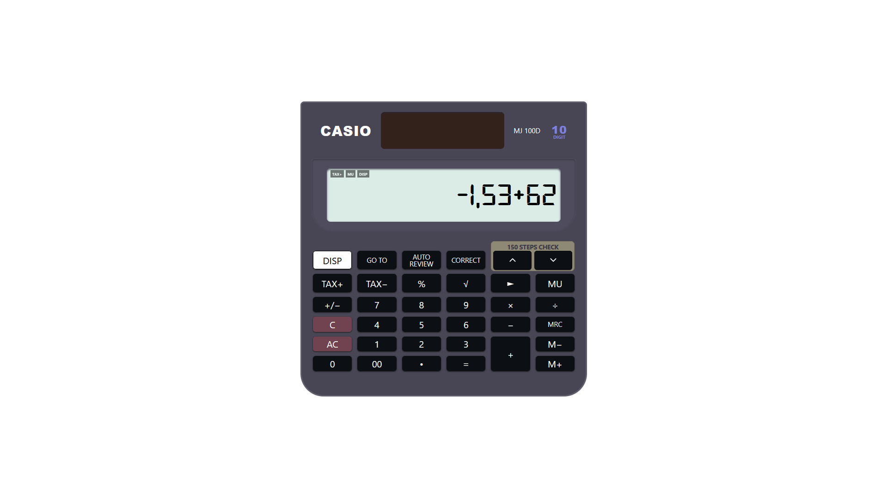

# Calculator

A small, responsive calculator built as a learning project. The goal is to practice Next.js, React, TypeScript, and Tailwind CSS by building an interactive page.



## Run the project

Install the dependencies and start the development server:

```bash
npm install
npm run dev
```

Open [http://localhost:3000](http://localhost:3000) in your browser. The development server updates the page when you save a change.

Useful commands:

```bash
npm run lint   # Check the code with ESLint
npm run build  # Create a production build
npm run start  # Serve the production build (run build first)
```

## Project structure

```text
app/
  components/
    calculator.tsx  Interactive calculator and its display/buttons
  globals.css       Global styles and calculator font classes
  layout.tsx        Root HTML layout and local font setup
  page.tsx          Home page and calculator key layout
public/
  Font/             Digital-style display font
```

## How it works

- `app/page.tsx` is the home page. In the Next.js App Router, `page.tsx` files define what is rendered for a route; this one defines the `/` route.
- The page creates a list of calculator keys and passes it to the `Calculator` component as a prop. Try changing a key's `label` or styling options to see how the page and component fit together.
- `app/components/calculator.tsx` starts with `"use client"` because it uses React state and click handlers. `useState` stores values such as the display text and whether calculator modes are active. Clicking a key updates that state, and React renders the changed display.
- The calculator parses and evaluates expressions in the browser. Tax and markup calculations are also handled in this component; there is no server, database, or API involved.
- Tailwind CSS utility classes style the page and make the calculator adapt to different screen sizes. The global CSS defines a few shared font styles.
- `app/layout.tsx` wraps the app in the root HTML document and loads the local digital font with `next/font/local`.

## Ideas for learning

1. Change the page metadata or the labels and order of keys.
2. Adjust the responsive Tailwind classes and test the page at different viewport widths.
3. Add a new piece of React state, such as a memory value, and connect it to a button.
4. Split a small part of the calculator display into a separate component and pass the values it needs through props.
5. Read the expression parser and trace how it handles operator precedence, percentages, and invalid input.

## Learn more

- [Next.js documentation](https://nextjs.org/docs)
- [Next.js App Router: Pages and layouts](https://nextjs.org/docs/app/getting-started/layouts-and-pages)
- [Next.js: Server and Client Components](https://nextjs.org/docs/app/getting-started/server-and-client-components)
- [React: Learn React](https://react.dev/learn)
- [Tailwind CSS documentation](https://tailwindcss.com/docs)